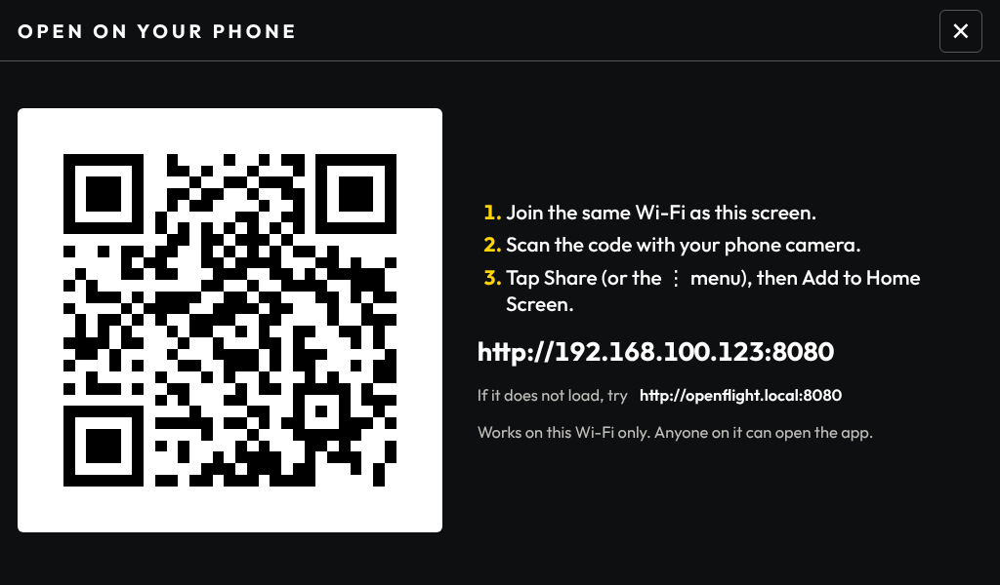
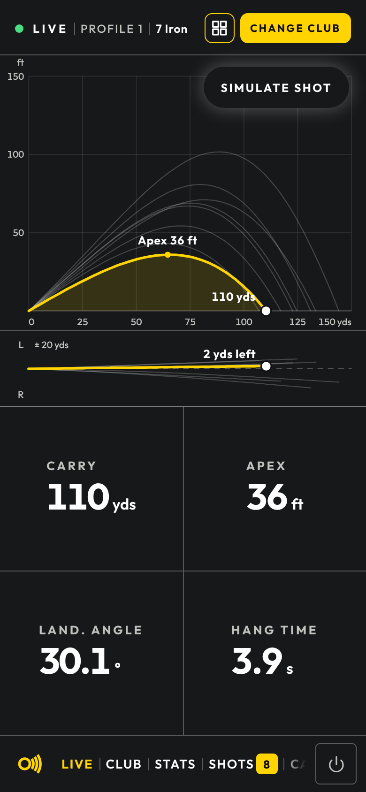

# Use It on Your Phone

The touchscreen's screens also work in a phone browser, and the page can sit on
the home screen and open full screen like an app. Nothing comes from an app
store: the phone opens the same page the Pi already serves.

For the native companion apps over Bluetooth or the shot stream, see
[Phone app connection](../ios-ble.md) instead.

## Open it

1. Join the phone to the same Wi-Fi as the Pi.
2. On the touchscreen, tap the footer logo, then **Open on your phone**.
3. Point the phone's camera at the QR code and open the link.

The address is also printed next to the code, for example
`http://192.168.1.23:8080`, so it can be typed by hand. The code uses the Pi's
IP address because a `.local` name does not resolve on every network; the
`.local` name is listed underneath as a second thing to try.

## Add it to the home screen

=== "iPhone"

    1. Open the link in **Safari**.
    2. Tap **Share**, then **Add to Home Screen**, then **Add**.

    The OpenFlight icon then opens full screen, without Safari's bars.

=== "Android"

    1. Open the link in **Chrome**.
    2. Tap the **⋮** menu, then **Add to Home screen**.

Every tab fits a phone held upright:

{ width="320" }

## Limits

- **Same Wi-Fi only.** The phone has to reach the Pi directly. It does not work
  over mobile data or from another network.
- **No offline mode.** The Pi serves plain HTTP, and browsers only allow
  service workers and offline storage over HTTPS. The icon opens nothing while
  the Pi is off or out of reach.
- **Android may add a shortcut, not an app.** Chrome only installs a page as an
  app over HTTPS. Over HTTP the home-screen icon can open as an ordinary
  browser tab, with the address bar showing.
- **No login.** Anyone on the Wi-Fi who opens the address gets the whole UI,
  including club and profile changes, Clear session and Shut down. Do not run
  OpenFlight on a network you do not trust.
- **The icon remembers one address.** If the router gives the Pi a new IP
  address the icon stops loading. Scan the code again, or reserve the Pi's
  address on the router.
- **One session, many screens.** Every phone and the touchscreen show the same
  shots, club and profile. Units, theme and language are set per device.

The **Open on your phone** button is hidden on a phone, since it is for the
kiosk.

## Related

- [TV Display Mode](display.md): a passive view for a TV or tablet
- [Running & modes](running.md#frequently-used-flags): changing the web port
